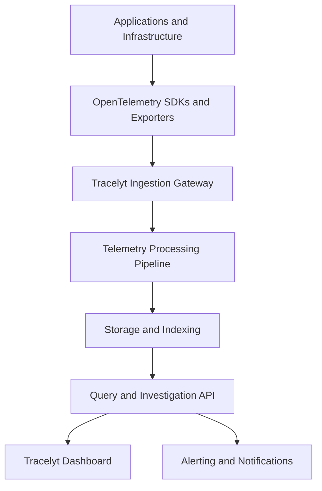

# Tracelyt
### Open-Source Observability for Modern Applications

**Understand your systems. Detect problems earlier. Debug with confidence.**

Tracelyt is an open-source observability platform designed to help developers and engineering teams monitor application health, investigate failures, understand distributed system behavior, and gain visibility into their software infrastructure.

The goal is to bring logs, metrics, distributed traces, service health, and actionable diagnostics into a unified platform that teams can self-host, extend, and operate on their own infrastructure.

Whether you're building a monolith, a microservices architecture, an API platform, or a distributed backend, Tracelyt aims to make production behavior easier to understand.

> **Project status:** Under active development. The architecture and capabilities described below represent the intended platform design. Individual features become available as their respective components are implemented and released.

---

## Table of Contents

- [What is Tracelyt?](#what-is-tracelyt)
- [Why Tracelyt?](#why-tracelyt)
- [Core Concepts](#core-concepts)
- [Planned Features](#planned-features)
- [Architecture](#architecture)
- [Repository Structure](#repository-structure)
- [Technology Stack](#technology-stack)
- [Security Principles](#security-principles)
- [Self-Hosting Philosophy](#self-hosting-philosophy)
- [Development Roadmap](#development-roadmap)
- [Getting Started](#getting-started)
- [Contributing](#contributing)
- [Project Governance](#project-governance)
- [License](#license)

---

## What is Tracelyt?

Modern applications rarely run as a single process. A single user request might pass through an API gateway, authentication service, multiple backend services, databases, message queues, and external APIs.

When something fails, developers need to understand not only *what* happened but also *where*, *why*, and *what was affected*.

Tracelyt is being designed to address this problem through a unified observability architecture.

It aims to provide three fundamental capabilities:

**1. Observe**

Collect and organize telemetry from applications and infrastructure, including logs, metrics, and distributed traces.

**2. Investigate**

Connect related events across services, identify errors and performance bottlenecks, and help developers follow a request through a distributed system.

**3. Act**

Support alerting, incident investigation, operational workflows, and extensible integrations so teams can respond to problems efficiently.

Tracelyt is intended to be self-hostable, extensible, and suitable for teams that want greater control over their observability infrastructure and telemetry data.

## Why Tracelyt?

Traditional monitoring often answers individual questions: Is the service running? How many requests failed? Which endpoint is slow?

Effective troubleshooting requires connecting those answers.

Tracelyt aims to connect service health, telemetry, and investigation workflows in one coherent platform.

| Challenge | Tracelyt's intended approach |
|---|---|
| Difficult production debugging | Correlated traces and contextual telemetry |
| Slow API responses | Latency analysis and bottleneck identification |
| Failures across microservices | Distributed request visibility |
| Noisy operational alerts | Configurable alerting and event correlation |
| Fragmented monitoring tools | A unified observability experience |
| Limited infrastructure control | Self-hosting and configurable deployment |
| Sensitive production telemetry | Data minimization, redaction, and access controls |

The objective is not simply to collect more data. It is to make operational data more useful.

## Core Concepts

### Logs

Logs record events that occur inside an application.

They can help developers investigate exceptions, unexpected behavior, failed operations, and application-specific events.

### Metrics

Metrics provide numerical measurements over time.

Examples include:

- Request rate and throughput
- Error rate
- Response latency
- CPU and memory utilization
- Queue depth and processing delays
- Database connection utilization

### Distributed Tracing

Distributed traces represent the journey of a request through different services.

A trace contains spans representing individual operations, such as an HTTP request, database query, or message-processing task.

Correlating these spans helps reveal where time is spent and where a request fails.

### Service Health

Service health provides an overview of operational conditions, including availability, error rates, latency, and telemetry freshness.

### Incidents and Alerts

Alerting helps teams identify conditions that require attention. Incident workflows can organize related alerts and provide context for investigation.

These concepts form the foundation of Tracelyt's intended observability experience.

---

## Planned Features

The following capabilities describe the project direction, not a claim that every feature is already implemented.

### 1. Unified Observability

- Centralized access to telemetry from multiple services.
- Correlation between traces, logs, and metrics.
- Service-level operational views.
- Environment-aware telemetry organization.
- Configurable retention and data handling.

### 2. Distributed Tracing

- Trace and span ingestion.
- Request-flow visualization.
- Service-to-service dependency visibility.
- Latency breakdowns.
- Error and failure investigation.

### 3. Telemetry Ingestion

The ingestion layer is intended to accept telemetry from instrumented applications and route it through a controlled processing pipeline.

Planned design considerations include:

- OpenTelemetry compatibility.
- OTLP-based ingestion.
- Request validation and payload limits.
- Authentication and authorization.
- Rate limiting and backpressure.
- Asynchronous processing for higher throughput.
- Safe handling of malformed or oversized payloads.

### 4. Alerting and Incident Workflows

The alerting component is intended to support configurable conditions, notification routing, and incident investigation.

Potential use cases include elevated error rates, increased latency, service unavailability, and abnormal telemetry patterns.

### 5. Intelligent Investigation

A future extension may use rule-based diagnostics and AI-assisted analysis to summarize failures, correlate evidence, and suggest possible investigation paths.

Any automated diagnosis should remain grounded in observable evidence. AI-generated explanations should not be treated as guaranteed root-cause findings.

### 6. Integrations

Tracelyt is intended to support integrations with common application frameworks, telemetry exporters, deployment environments, and notification systems.

Open standards and modular interfaces will be preferred wherever practical.

---

## Architecture

Tracelyt is planned as a modular platform, with individual repositories responsible for distinct concerns.

### High-level architecture

This is the intended logical flow; the final implementation and deployment topology may evolve.

### Platform components

**Control Plane**

Manages platform-level resources such as projects, users, permissions, and configuration. It is separate from the high-volume telemetry data path.

**Ingestion Gateway**

Receives telemetry from applications, validates incoming requests, applies ingestion security controls, and forwards accepted data to the processing layer.

**Telemetry Pipeline**

Processes telemetry through stages such as normalization, enrichment, redaction, and routing. Asynchronous messaging may be used where appropriate.

**Query Engine**

Provides APIs for retrieving and analyzing stored telemetry. Its design must account for filtering, time ranges, pagination, and query resource limits.

**Alerting and Notifications**

Evaluates configured conditions and coordinates delivery to supported notification destinations.

**Investigation and AI Services**

A potential extension for evidence-based diagnostics and investigation assistance, built separately from the core ingestion path.

---

## Repository Structure

The Tracelyt organization is intended to use a multi-repository architecture.

| Repository | Responsibility |
|---|---|
| `tracelyt-control-plane` | Platform APIs, project management, identity integration, and access control |
| `tracelyt-ingestion` | Telemetry ingestion gateway and protocol handling |
| `tracelyt-telemetry-pipeline` | Telemetry normalization, enrichment, redaction, and routing |
| `tracelyt-query-engine` | Telemetry retrieval, filtering, and query APIs |
| `tracelyt-alerting` | Alert evaluation and incident-related workflows |
| `tracelyt-ai-investigator` | Future AI-assisted investigation capabilities |
| `tracelyt-notifications` | Notification delivery and channel integrations |
| `tracelyt-integrations` | External integrations and telemetry adapters |
| `tracelyt-deploy` | Deployment configurations and self-hosting resources |
| `tracelyt-specs` | Architecture decisions, API contracts, and engineering specifications |
| `tracelyt-docs` | User documentation, guides, and operational references |

Repository names describe intended responsibilities. Each repository's own README should document its actual implementation status, supported interfaces, and setup instructions.

---

## Technology Stack

Tracelyt's technology choices will be driven by performance, maintainability, security, and operational simplicity.

The intended architecture may use:

- **Backend services:** Java and Spring Boot where appropriate.
- **Telemetry standards:** OpenTelemetry and OTLP.
- **Messaging:** Kafka or another suitable asynchronous transport.
- **Storage:** Databases and analytical storage selected for each workload.
- **API interfaces:** Versioned REST APIs and documented telemetry protocols.
- **Deployment:** Docker-based development and deployment, with orchestration support as the platform matures.
- **Automation:** CI pipelines for testing, validation, dependency checks, and release workflows.

Not every component needs the same technology. Each repository should document its actual stack in its own README rather than imply that the entire platform uses a single framework.

---

## Security Principles

Security is a foundational design requirement, particularly because observability systems can receive sensitive application data.

### Authentication and Authorization

- Authenticate access to protected APIs.
- Apply explicit permissions to platform operations.
- Enforce project and tenant boundaries on the server side.
- Use least-privilege access for service credentials.

### Secure Ingestion

- Validate request formats and payload sizes.
- Apply rate limits and resource controls.
- Reject unauthorized requests.
- Avoid logging authentication secrets or raw sensitive payloads.
- Handle malformed input without exposing internal implementation details.

### Telemetry Privacy

- Minimize the collection of personally identifiable information.
- Support redaction of sensitive fields before persistence wherever feasible.
- Define retention and deletion policies.
- Protect telemetry in transit and at rest.
- Restrict access to sensitive trace attributes and logs.

### Supply Chain and Development Security

- Pin or constrain dependencies appropriately.
- Scan dependencies for known vulnerabilities.
- Run automated tests and static analysis.
- Protect release credentials and CI secrets.
- Publish security reporting instructions and responsible disclosure guidance.

These principles describe the intended security posture; individual controls must be verified against each repository's implementation.

---

## Self-Hosting Philosophy

Tracelyt aims to give users control over where their observability data is processed and stored.

The intended deployment model should make it possible to operate the platform on infrastructure managed by the user or organization.

Self-hosting documentation will need to cover:

- Prerequisites and supported environments.
- Environment configuration and secret management.
- Database initialization and migrations.
- Service health checks.
- Persistent storage and backups.
- Network exposure and TLS.
- Upgrade and rollback procedures.
- Resource requirements and troubleshooting.

A complete, supported one-command installation should be documented only after the corresponding deployment setup has been implemented and tested.

---

## Development Roadmap

Tracelyt's development is organized around building reliable foundations before adding higher-level functionality.

- [ ] **Foundation:** Repository standards, architecture specifications, CI, and development documentation.
- [ ] **Control Plane:** Core resource APIs, identity integration, and authorization.
- [ ] **Ingestion:** Secure request handling, protocol validation, and ingestion tests.
- [ ] **Telemetry Pipeline:** Normalization, processing, and routing.
- [ ] **Storage and Queries:** Persistence, indexing, and retrieval APIs.
- [ ] **Observability UI:** Service views, traces, and operational dashboards.
- [ ] **Alerting:** Configurable conditions and notification delivery.
- [ ] **Self-Hosting:** Validated deployment configuration and operational guides.
- [ ] **Advanced Investigation:** Correlation, diagnostic workflows, and optional AI-assisted capabilities.
- [ ] **Production Readiness:** Load testing, resilience testing, security review, and release automation.

Roadmap items should be checked off only when the corresponding functionality has been implemented and validated.

---

## Getting Started

Tracelyt is under development, so the exact setup procedure depends on the repository and the components currently available.

### For contributors

1. Explore the repository you want to work on.
2. Read its README and contribution guidelines.
3. Review the architecture specifications and open issues.
4. Install the documented prerequisites.
5. Run the available tests before submitting changes.

Start with the relevant repository:

- Control plane: `tracelyt-control-plane`
- Ingestion: `tracelyt-ingestion`
- Architecture and API contracts: `tracelyt-specs`
- Deployment resources: `tracelyt-deploy`

Do not assume that a complete end-to-end platform is runnable until the required services and deployment configuration are available.

---

## Contributing

Tracelyt welcomes contributions from developers interested in observability, distributed systems, backend engineering, infrastructure, and open-source software.

Contributions may include:

- Bug fixes and test coverage.
- Architecture and API documentation.
- Telemetry protocol support.
- Performance and reliability improvements.
- Security hardening.
- Deployment automation.
- Integrations and developer tooling.

### Contribution workflow

1. Find an existing issue or describe the problem you want to solve.
2. Discuss significant architectural changes before implementing them.
3. Create a focused branch.
4. Add tests for behavior changes.
5. Run the relevant checks.
6. Submit a pull request with a clear explanation and verification steps.

Please follow the contribution guidelines and code standards of the individual repository.

Security vulnerabilities should be reported privately through the security reporting channel documented by the project, rather than disclosed in a public issue.

---

## Project Governance

Tracelyt is being developed as an open-source project under the `Tracelyt-Systems` organization.

The long-term goal is to build a transparent, community-driven platform with clear engineering standards, documented design decisions, and maintainable service boundaries.

Before public release, the organization should publish and consistently apply its license, contribution policy, code of conduct, and security reporting process.

The license and governance documents in the repository are authoritative.

---

## License

The applicable license will be specified in the repository's `LICENSE` file.

Until that file is present and its terms are confirmed, do not assume that the project is available under a particular open-source license.

---

## Vision

Observability should help developers understand their systems, not force them to assemble disconnected tools just to diagnose a production issue.

Tracelyt aims to make that experience more unified, transparent, extensible, and accessible to teams that want control over their own infrastructure.

**Tracelyt — Observe clearly. Investigate confidently. Build reliably.**
